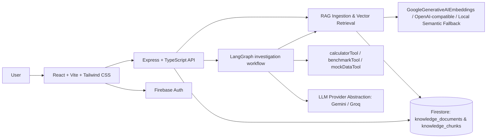

# MORPHOS

Autonomous AI Experimentation Platform

"An AI system that learns by experimenting."

MORPHOS is a local-first AI investigation platform for technical problem-solving. It combines a React dashboard, an Express API, Firebase Authentication, Firestore persistence, and a LangGraph-driven investigation workflow to turn a user question into a structured, hypothesis-based analysis flow.

## Overview

The platform is designed to help users investigate complex technical issues through a repeatable loop:

1. Interpret the question
2. Generate candidate hypotheses
3. Select an experiment strategy
4. Run the experiment
5. Analyze results
6. Score confidence
7. Finalize the conclusion or continue iterating

This makes the system more transparent than a typical chatbot because each stage is observable and stateful.

## Problem

Modern technical investigations often involve ambiguity, incomplete information, and iterative hypothesis testing. Many AI tools produce vague answers without clearly showing how they reasoned or which experiments they considered. MORPHOS addresses that by formalizing the workflow as an evidence-driven investigation system.

## Features

- LangGraph-based investigation workflow with stateful transitions
- Retrieval-Augmented Generation (RAG) knowledge layer with semantic chunking, vector embeddings, and Firestore-backed vector retrieval
- Context-aware hypothesis generation and result analysis with explicit KB vs. reasoning attribution
- Structured hypothesis generation and confidence scoring
- Experiment execution through deterministic, tool-driven simulation
- Firebase Email/Password authentication
- Firestore-backed investigation and knowledge base persistence
- Authenticated per-user and per-project isolation
- React + Vite frontend with lifecycle timeline and result panels
- Express backend with health, investigation, and knowledge API routes
- Environment-driven LLM and embedding provider abstraction (Gemini / Groq / OpenAI-compatible) with graceful deterministic fallback mode
- Security-conscious env handling with secrets kept out of source control

## Architecture



## LangChain + LangGraph workflow

The backend investigation graph follows a repeatable and observable investigation lifecycle:

1. `interpretQuestion` — classifies domain and frames the problem
2. `retrieveKnowledge` — embeds the query and performs top-k cosine similarity retrieval over the user's scoped knowledge chunks
3. `generateHypotheses` — synthesizes candidate hypotheses grounded in retrieved KB chunks (with explicit attribution)
4. `selectExperiment` — chooses the most informative experiment tool
5. `executeExperiment` — runs deterministic tool telemetry
6. `analyzeResults` — correlates experiment telemetry with retrieved KB context and domain reasoning
7. `evaluateConfidence` — scores evidence and decides whether to loop or finalize
8. `finalize` — produces the verified executive conclusion

The workflow stores structured state including:
- question
- interpretedProblem
- retrievedContext
- ragSummary
- hypotheses
- selectedHypothesis
- experiment
- experimentResult
- analysis
- confidence
- iteration
- maxIterations
- events
- finalConclusion
- status

A safe iteration cap prevents runaway loops during local development and demo usage.

## RAG (Retrieval-Augmented Generation) Layer

MORPHOS includes a genuine LangChain-compatible RAG pipeline under `backend/src/rag/` so investigations are grounded in a user's own runbooks, incident postmortems, architecture notes, and telemetry exports.

### Ingestion flow
1. Authenticated user submits text/markdown/JSON/HTML via `POST /api/knowledge`.
2. `backend/src/rag/chunker.ts` validates and extracts clean text (rejecting empty, binary, or malformed payloads), tracks markdown `#` headings and `[Page N]` / `--- Page N ---` markers, and splits text recursively with configurable overlap (`RAG_CHUNK_SIZE`, `RAG_CHUNK_OVERLAP`).
3. Every chunk preserves rich metadata: `documentId`, `sourceName`, `chunkId`, `chunkIndex`, `totalChunks`, `userId`, `projectId`, optional `investigationId`, `section`, `page`, and `createdAt`.
4. `backend/src/rag/embeddings.ts` generates dense embeddings via `GoogleGenerativeAIEmbeddings` (`GEMINI_API_KEY`), OpenAI-compatible `/embeddings` (`EMBEDDING_API_KEY`), or deterministic 256-dim local semantic n-gram fallback (`LocalSemanticEmbeddings`) when external embedding APIs are unconfigured or rate-limited (`429`).
5. `backend/src/services/firebase.ts` persists the document metadata in `knowledge_documents` and chunk vectors in `knowledge_chunks` in Firestore (with bounded in-memory fallback when Firebase Admin is unavailable or in test mode).

### Retrieval & LangGraph integration
1. Before hypothesis generation, the `retrieveKnowledge` node embeds the user's investigation question and queries `MorphosVectorStore` (extending LangChain's `VectorStore`).
2. `MorphosVectorStore` filters candidates strictly by `userId` (and optional `projectId` / `investigationId`), computes cosine similarity, applies `RAG_MIN_SCORE`, and returns the top-k chunks (`RAG_TOP_K`).
3. Retrieved chunks are injected into LangGraph state (`retrievedContext`, `ragSummary`).
4. `generateHypotheses`, `analyzeResults`, and `finalize` use context-aware prompts and deterministic attribution rules that:
   - Cite `[KB: <sourceName>]` for facts from retrieved chunks
   - Separate retrieved KB context from model reasoning and experiment telemetry
   - Never fabricate KB facts
   - Continue working normally when retrieval returns zero chunks or encounters vector/embedding errors

### User & project isolation
- `userId` is always derived from the verified Firebase ID token (`req.user.uid`), never from request bodies.
- `MorphosVectorStore` and Firestore queries enforce `userId` filtering on all reads, vector searches, and deletions.
- `projectId` scopes knowledge documents and vector retrieval to a specific system/project workspace.
- `firestore.rules` defines matching `request.auth != null && resource.data.userId == request.auth.uid` rules for `knowledge_documents` and `knowledge_chunks`.

## Firebase Authentication

MORPHOS supports Firebase Email/Password authentication on the frontend and verifies Firebase ID tokens on the backend before processing investigation requests.

Behavior:
- User registers or logs in with Firebase client SDK
- Client gets a Firebase ID token
- Backend reads the Authorization header and verifies the token with Firebase Admin SDK
- The decoded UID is used as the real ownership source for persistence and history access

This ensures the app does not trust a user-provided UID in the request body.

## Firestore persistence

Investigation records are stored in Firestore using the authenticated UID as the ownership key. The backend persists structured results and exposes history endpoints that return only the current user’s records.

Important note:
- Real Firestore write and read functionality has been verified in the local environment.
- Firestore rules are present in the repository, but their deployment and runtime testing remain separate from the app code and are not claimed as verified unless the Firebase CLI deployment is completed.

## React + Vite frontend

The frontend is a single-page app built with React and Vite. It includes:
- authentication state
- investigation input
- workflow timeline
- current hypothesis view
- investigation history list
- result and final conclusion panels

## Express backend

The backend exposes:
- health endpoint
- investigation execution endpoint
- investigation history endpoint
- authenticated investigation detail access

It is designed to keep the AI workflow and API concerns separate while still supporting local development and real Firebase-backed ownership enforcement.

## Gemini integration

Gemini is integrated through LangChain, but the current runtime limitation is free-tier quota exhaustion. When the provider is unavailable, the app retains deterministic local behavior so the workflow continues without failing the application itself.

Current status:
- LangChain integration is present and working
- LangGraph workflow remains intact
- Tool execution remains intact
- Gemini live calls are currently blocked by provider quota exhaustion (HTTP 429)

The application clearly reports this availability problem instead of pretending the live model is operational.

## Experiment and tool system

The investigation graph executes deterministic experiment flows via built-in tools such as:
- calculatorTool
- benchmarkTool
- mockDataTool

These simulate technical investigation paths so the platform remains testable and usable even when an external LLM provider is unavailable.

## Project structure

```text
.
├── .env.example
├── .gitignore
├── README.md
├── firestore.rules
├── package.json
├── package-lock.json
├── backend/
│   ├── Dockerfile
│   ├── package.json
│   ├── src/
│   │   ├── agents/
│   │   ├── config.ts
│   │   ├── routes/
│   │   ├── server.ts
│   │   └── services/
│   └── tsconfig.json
├── frontend/
│   ├── package.json
│   ├── src/
│   ├── index.html
│   ├── vite.config.ts
│   └── tsconfig.json
└── docker-compose.yml
```

## Local setup

1. Install dependencies:

```bash
npm install
```

2. Create a local env file from the example:

```bash
cp .env.example .env
```

3. Fill in any required values locally as needed for your Firebase and Gemini configuration.

4. Start the backend:

```bash
npm run dev --workspace backend
```

5. Start the frontend:

```bash
npm run dev --workspace frontend
```

6. Open the app locally in the browser:
- Frontend: http://localhost:5173
- Backend: http://localhost:4000/api

## Environment variables

Use only locally managed values and keep secrets out of source control.

```env
PORT=4000
FRONTEND_ORIGIN=http://localhost:5173
LLM_PROVIDER=auto
GEMINI_API_KEY=your_gemini_api_key
GEMINI_MODEL=gemini-2.0-flash
GROQ_API_KEY=your_groq_api_key
GROQ_MODEL=llama-3.3-70b-versatile
EMBEDDING_PROVIDER=auto
EMBEDDING_MODEL=text-embedding-004
EMBEDDING_API_KEY=
EMBEDDING_BASE_URL=https://api.openai.com/v1
RAG_CHUNK_SIZE=700
RAG_CHUNK_OVERLAP=120
RAG_TOP_K=4
RAG_MIN_SCORE=0.15
RAG_ALLOW_LOCAL_EMBEDDING_FALLBACK=true
FIREBASE_PROJECT_ID=your_firebase_project_id
FIREBASE_API_KEY=your_firebase_api_key
FIREBASE_AUTH_DOMAIN=your_project.firebaseapp.com
FIREBASE_STORAGE_BUCKET=your_project.appspot.com
FIREBASE_MESSAGING_SENDER_ID=1234567890
FIREBASE_APP_ID=your_firebase_app_id
FIREBASE_MEASUREMENT_ID=G-XXXXXXXXXX
```

No private keys or service-account JSON should be committed to the repository.

## Running tests & validating RAG

Run the full backend test suite (including unit, isolation, fallback, LangGraph RAG injection, and Supertest API tests) and workspace builds:

```bash
npm test --workspace backend
npm run build --workspace backend
npm run build --workspace frontend
```

## API endpoints

### Health

```http
GET /api/health
```

### Knowledge Base (RAG)

```http
POST /api/knowledge
Authorization: Bearer <firebase-id-token>
Content-Type: application/json
```

```json
{
  "sourceName": "gateway-postmortem.md",
  "projectId": "edge-gateway",
  "contentType": "text/markdown",
  "content": "# API Latency Incident\nUpstream TLS handshake reuse was disabled..."
}
```

```http
GET /api/knowledge?projectId=edge-gateway
Authorization: Bearer <firebase-id-token>
```

```http
POST /api/knowledge/search
Authorization: Bearer <firebase-id-token>
Content-Type: application/json
```

```json
{
  "query": "Why is API latency spiking on edge gateway?",
  "projectId": "edge-gateway",
  "topK": 4
}
```

```http
DELETE /api/knowledge/:id
Authorization: Bearer <firebase-id-token>
```

### Investigate

```http
POST /api/investigate
Authorization: Bearer <firebase-id-token>
Content-Type: application/json
```

Body (`projectId` and `topK` are optional):

```json
{
  "question": "Why is API latency increasing?",
  "projectId": "edge-gateway",
  "topK": 4
}
```

### Investigation history

```http
GET /api/investigations
Authorization: Bearer <firebase-id-token>
```

## Security

- Secret values are kept in local environment files and ignored by Git
- Firebase Admin credentials are never exposed to the frontend
- Backend token verification is required for authenticated routes
- Ownership is derived from the verified Firebase UID rather than request data
- No secrets or private keys are committed to source control

## Current limitations

- Gemini free-tier quota exhaustion can temporarily block live LLM access
- Firestore security rules are present in the repo but require Firebase CLI deployment and runtime validation before being claimed as deployed
- Local demo behavior intentionally uses deterministic tool execution when external AI is unavailable

## Future improvements

- Connect to more real telemetry sources and observability pipelines
- Add richer experiment strategy libraries
- Expand Firestore rules and production deployment validation
- Add more artifact export and reporting tooling
- Support additional AI providers with graceful fallback chaining

## Notes

This project is intentionally structured so the investigation engine, authentication layer, and persistence model can evolve without rewriting the core workflow. The current verified state is a working local platform with Firebase-backed auth and Firestore persistence, while the live Gemini provider remains constrained by quota availability.
